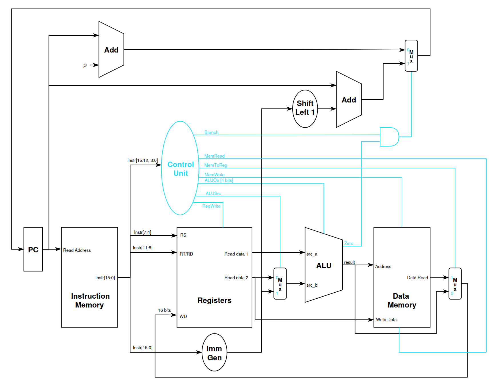

# 16-bit CPU
Single cycle processor written in Verilog. FPGA implementation runs a Fibonnaci sequence (first 10 numbers) and targets Digilent Basys3 FPGA board at 100 MHz. Clock rate is slowed in demo to ~30 Hz for visibility purposes. The demo can be found in the images folder.

## CPU Architecture
